> [!NOTE]
> 本仓库为备份仓库，不直接上传/管理文件，Pull Request 相关入口已关闭
> 最新备份时间：20260831

## 📁 课程目录结构

为了确保资料清晰易查，所有课程目录均统一采用以下结构进行组织：

```text
课程目录/
└── [课程名称]/
    ├── 01-历年真题/          # 期末试卷、期中试卷、样卷、模拟卷及测试题库
    ├── 02-课件与教材/        # 授课PPT、电子教材、讲义及考试大纲
    ├── 03-笔记与复习资料/     # 考前突击笔记、知识点总结、思维导图、名词解释、习题解答
    └── 04-实验与作业/        # 实验报告与数据表(XLSX)、平时作业及答案、课程论文、实习报告书、工程图纸
```

## 📄 使用协议

> [!WARNING]
> 1. 本项目所有资料均采用 **[CC BY-NC 4.0 (知识共享 署名-非商业性使用 4.0 国际许可协议)](/LICENSE)** 进行许可。版权归各上传/维护者所有，**严禁用于任何商业用途**，否则将承担法律责任
> 2. 严禁上传引流内容，恶意、恶搞内容，携带计算机病毒的内容
>
> 本站及认证系统具有完善的审计（来源追踪）功能。若您违反上述协议，核验后，我们将拉黑您所在的**整个班级**并于本站公示，后续无法访问本组织提供的任何服务

关于 **CC BY-NC 4.0**：

| 类型 | 说明                                   |
| :--: | -------------------------------------- |
|  ✅  | 任意分享、复制、转载、改编、二次创作   |
|  ⚠️  | 必须注明出处、附许可链接、说明是否修改 |
|  🚫  | 严禁用于商业用途                       |
|  🔒  | 不得额外添加法律或技术限制             |

## 贡献 ｜ 上传资源

本仓库有以下两种贡献方式：

网页端直接上传：已登录的普通用户均有管理权限

☁️ 建议上传的资源类型：

- PDF、PPT、攻略、笔记、期末试卷、电子书、物理实验报告...

❓ 不建议上传的资源类型：

- 零散图片
- 平时作业、课程设计
- 需要长期更新的项目
- 需要单独管理的大型项目
- 服务于、或与学校相关的开源软件/项目

> 此类内容可上传至本组织仓库单独管理。若内容不符合要求，本站管理员将协助迁移或直接删除。

## 🛠️ 维护与贡献规范

> [!TIP]
> 如果看不懂以下内容，可以将整篇内容丢给 AI 以协助理解

为维护仓库的整洁度与规范性，请所有贡献者在提交资料时遵守以下约定：

### 1. 课程命名

* **使用标准中文全称**：文件夹名称必须使用学校教务系统中的标准课程全称
* **避免特殊符号**：不得包含 `[ ]`、`/`、`\`、`*`、`?` 等易引起转义歧义的字符。涉及专业或类别标注时，一律使用全角括号 `【 】`（例如：`高等数学【机电】`）
* 若某课程暂无对应类型资料，如「历年真题」，则**不创建**该空白文件夹

### 2. 文件命名

为了方便按时间与类型检索，建议遵循以下文件命名约定：

| 资料类型 | 推荐命名格式 | 示例 |
| :--- | :--- | :--- |
| **历年试卷** | `[学年]_[学期]_[卷型]_[课程名].[后缀]` | `24-25_2_A_电路原理.pdf` |
| **试卷答案** | `[学年]_[学期]_[卷型]-答案_[课程名].[后缀]` | `23-24_1_A-答案_马克思主义基本原理.pdf` |
| **复习资料** | `[资料类型]_[说明]_[课程名].[后缀]` | `考前突击笔记_电路原理.pdf` |
| **实验与作业**| `[序号]_[名称]_[说明].[后缀]` | `实验02-液体表面张力系数的测定.pdf` |

### 3. 隐私保护

**保护「个人」与「他人」隐私**：在上传实验报告、平时作业或课程论文前，请务必去除个人信息（如学号、姓名、专业班级、导师名称等）

### 4. 添加水印

作为上传/维护者，您可以选择为自己上传的内容添加水印（或数字水印）。添加的水印需符合以下要求：

- 不得严重遮盖文件内容
- 不得披露任何联系方式

### 5. 核验提交

上传之前，对上传的文件进行核查，确认没有错误提交如下内容：

- 重复的文件
- 冗余的二进制文件
- 与当前科目无关的文件
- 其它路径下已存在的文件
- 侵犯他人隐私/版权的文件

## 来源披露

本仓库内大部分文件源自「[课程攻略共享计划](https://github.com/Royfor12/CQUT-Course-Guide-Sharing-Scheme)」
